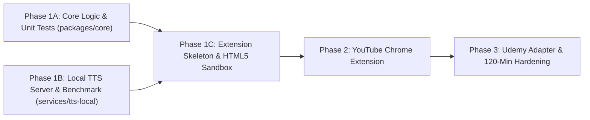

# DubCera — Master Implementation Roadmap (`plans/`)

> **Trạng thái:** Sẵn sàng triển khai code  
> ** Kiến trúc tham chiếu:** [../DubCera_README.md](../DubCera_README.md) & [../DubCera_Architecture_Flow.md](../DubCera_Architecture_Flow.md) (`v2.0`)  
> **Môi trường máy phát triển đã xác minh:** Windows · `Node v25.9.0` · `pnpm 10.33.2` · `Python 3.12.10` · `uv 0.12.1` · CPU `Intel Core i3-12100F` · GPU `AMD Radeon RX 6800 XT`

---

## 1. Hình hài sản phẩm & Lý do chia 2 nửa

DubCera không phải một website đơn lẻ mà gồm **2 thành phần gọn nhẹ phối hợp trực tiếp trên máy người dùng**:

1. **`apps/extension` (Chrome Extension — WXT + TypeScript + React):**
   - Chạy trực tiếp trên tab YouTube / Udemy / HTML5 Video.
   - Đọc phụ đề khả dụng, hiển thị hộp phụ đề 1–2 dòng (`DisplayChunk`) trong Shadow DOM, giảm nhỏ tiếng gốc của video, bắt thao tác `Play / Pause / Seek / Ratechange` và phát giọng đọc tiếng Việt tuần tự.
   - Lưu trữ bền vững bản dịch & trạng thái từng câu trong `IndexedDB` (`VideoManifestStore`).
2. **`services/tts-local` (Local Companion Service — Python 3.12 + FastAPI tại `127.0.0.1:8765`):**
   - Chạy ngầm dưới máy tính cá nhân để gánh các model AI TTS tiếng Việt (`VieNeu-TTS ONNX` / `Piper ONNX` / nhánh thử nghiệm GPU) và lưu trữ hàng GB file âm thanh `.wav` bền vững trên ổ cứng theo mã băm `SHA-256`.
   - Được khóa bảo mật chặt bằng loopback `127.0.0.1`, kiểm tra `Origin` của Extension và header `X-DubCera-Token`.

---

## 2. Sơ đồ thứ tự các Phase triển khai



| Thứ tự | Tài liệu chi tiết | Mục tiêu trọng tâm | Tiêu chí hoàn thành (Definition of Done) |
| :---: | :--- | :--- | :--- |
| **1A** | [Phase_1A_Core_Domain_And_Tests.md](./Phase_1A_Core_Domain_And_Tests.md) | Xây `packages/core`: Parser `.vtt/.srt`, Grouper, `DisplayChunk`, `DualClockSpeedPlanner`, `PlaybackIntentMachine`, `CacheKeyBuilder` | `pnpm test` xanh 100% trên toàn bộ 8 bất biến `I1`–`I8` |
| **1B** | [Phase_1B_Local_TTS_Service_And_Benchmark.md](./Phase_1B_Local_TTS_Service_And_Benchmark.md) | Xây `services/tts-local`: FastAPI `127.0.0.1:8765`, Security guard, `Singleflight`, Disk Cache `SHA-256`, tích hợp TTS & đo benchmark máy thật | Xuất được WAV tiếng Việt chuẩn, đo rõ `TTFB` & `RTF` trên `i3-12100F + RX 6800 XT` |
| **1C** | [Phase_1C_Extension_Skeleton_And_HTML5_Sandbox.md](./Phase_1C_Extension_Skeleton_And_HTML5_Sandbox.md) | Xây `apps/extension` + Trang HTML5 Sandbox: ghép Dịch + TTS + IndexedDB + Tua `Pause-Buffer-Resume` + Sub 1–2 dòng + Voice | Mở video dài trên Sandbox: tua vùng mới tự Pause ~2s rồi đọc tiếp, tua vùng cũ phát ngay, F5 không mất cache |
| **2** | [Phase_2_YouTube_Integration.md](./Phase_2_YouTube_Integration.md) | Kết nối trình phát YouTube thật: bắt track phụ đề, xử lý chuyển bài SPA, bắt nút Play/Pause gốc, hoàn thiện Popup UI | Mở video bài giảng tiếng Anh trên YouTube nghe lồng tiếng Việt + hiện Sub mượt mà |
| **3** | [Phase_3_Udemy_And_Long_Video_Hardening.md](./Phase_3_Udemy_And_Long_Video_Hardening.md) | Kết nối khóa học Udemy hợp lệ, Glossary Unity/Code, trượt giải phóng RAM (`Sliding Window`), fallback khi rớt server TTS | Xem liên tục bài giảng 60–120 phút không rò rỉ RAM, không đè giọng, không cắt câu |

---

## 3. Cấu trúc Monorepo đích

```text
DubCera/
├─ DubCera_README.md
├─ DubCera_Architecture_Flow.md
├─ plans/                           # Thư mục đặc tả triển khai từng Phase (hiện tại)
├─ package.json
├─ pnpm-workspace.yaml
├─ tsconfig.base.json
├─ packages/
│  └─ core/                         # Thuần TypeScript, 0 phụ thuộc DOM trình duyệt
├─ services/
│  └─ tts-local/                    # Python 3.12 + uv + FastAPI + Local TTS Engines
└─ apps/
   └─ extension/                    # WXT Chrome Extension + React Popup + HTML5 Sandbox
```

---

## 4. Tám quy tắc bất biến kiểm tra xuyên suốt mọi Phase

1. **`I1`:** Không bỏ câu dài; tua vào giữa câu mặc định đọc trọn từ đầu câu đó.
2. **`I2`:** Cấm cắt đuôi PCM/WAV để ép vừa khung phụ đề.
3. **`I3`:** Chỉ một giọng tiếng Việt phát tại một thời điểm (`nextStartClock >= prevEndClock + 60ms`).
4. **`I4`:** Tốc độ đọc hiệu dụng không vượt `maxEffectiveSpeechRate`, không nhân chồng `video.playbackRate` hai lần.
5. **`I5`:** `audioCacheKey` băm đủ mọi tham số tổng hợp; chỉ đánh dấu `READY` khi file WAV tồn tại và giải mã hợp lệ.
6. **`I6`:** An toàn `sessionId` và `configVersion` khi tua liên tục hoặc đổi giọng giữa chừng.
7. **`I7`:** Không âm thầm nuốt lỗi dịch/TTS; luôn hiển thị trạng thái và phụ đề dự phòng.
8. **`I8`:** Quản lý tường minh `PlaybackIntent ("PLAY" | "PAUSE")` + `userActionRevision`; không tự ý phát lại nếu người dùng đã bấm dừng.
